<p align="center">
  
</p>

<p align="center">
  <a href="https://adelyaaibolova.github.io"></a>
  <a href="https://www.linkedin.com/in/adelya-aibolova"></a>
  <a href="mailto:adelya.aibolova@outlook.com"></a>
</p>

<p align="center">
  
  
  
  
</p>

<p align="center">
  
</p>

### about

```js
const adelya = {
  based:    "Budapest, Hungary · Germany from 2027",
  studying: "European Master in Lexicography (EMLex), Erasmus Mundus · FAU, Nancy, Budapest",
  building: "a human-annotated German–Kazakh benchmark for LLM translation",
  learning: "Machine Learning Specialization (Andrew Ng)",
  speaks:   ["Kazakh", "Russian", "English", "German", "French"],
  interests:["NLP for low-resource languages", "LLM evaluation", "Turkic syntax", "corpora"],
  rule:     "don't trust a model's own confidence. check it by hand.",
};
```

<details>
<summary><b>how I got here</b> · click for the short version</summary>
<br>

I trained as a teacher of English and German in Almaty (BEd, with distinction), then moved to Europe for the Erasmus Mundus master's in lexicography: Erlangen, then Nancy, now Budapest. Somewhere between dictionaries and corpora I started writing the code myself, and now I mostly work where language data meets software: building datasets, pipelines and evaluations, especially for Kazakh and other Turkic languages.

</details>

### experience

<table>
<tr>
<td width="34%"><b>Technical intern</b><br><sub>Fränkisches Wörterbuch · Bavarian Academy of Sciences and Humanities &amp; FAU · Oct – Nov 2026</sub></td>
<td>Python (lxml, XPath) pipeline that turns <b>74,580</b> XML dictionary entries into semantic HTML in about 80 seconds, evaluated as an alternative to XSLT.</td>
</tr>
<tr>
<td><b>Research intern</b><br><sub>Chair of Corpus and Computational Linguistics · FAU Erlangen-Nürnberg · Jul – Aug 2026</sub></td>
<td>Designed and ran a lexical evaluation of LLMs for German→Kazakh translation, with a seven-category error taxonomy and a pilot lexical-semantic benchmark.</td>
</tr>
</table>

### projects

<table>
<tr>
<td width="50%" valign="top">
<b>German–Kazakh Lexical Evaluation</b><br>
<sub>master's thesis · paper in preparation</sub><br><br>
600 German items, 1,800 outputs from ChatGPT, DeepSeek and Gemini, double-annotated by native speakers. To my knowledge the first open lexical evaluation resource for this language pair. <b>95.0%</b> correct, with errors clustering in compound nouns (p = 0.034).
</td>
<td width="50%" valign="top">
<b>WBF Transformation Pipeline</b><br>
<sub>internship · Bavarian Academy of Sciences</sub><br><br>
Declarative <code>@xpath</code> extractors, an <code>Entry</code> dataclass and three execution engines (sequential, threads, processes). Zero dependencies, tested in CI.
</td>
</tr>
<tr>
<td valign="top">
<a href="https://github.com/Adelyaaibolova/mindwords-corpus"><b>MindWords</b></a> · <a href="https://adelyaaibolova.github.io/mindwords-corpus/">live dictionary</a><br>
<sub>corpus linguistics · team project</sub><br><br>
120,826 YouTube comments on mental health cleaned into a 2.2M-token corpus, and a learner's dictionary written from the evidence, with translations into four languages.
</td>
<td valign="top">
<a href="https://adelyaaibolova.github.io/medieval-bestiary-of-venture-capital/"><b>The Medieval Bestiary of Venture Capital</b></a><br>
<sub>lexicography · TEI Lex-0</sub><br><br>
Unicorns, cockroaches, camels: 66 animal metaphors of venture capital, each described twice, as a medieval allegory and as a modern dictionary entry with 93 verified corpus quotations.
</td>
</tr>
<tr>
<td valign="top">
<a href="https://github.com/Adelyaaibolova/dev-process-analytics"><b>Development Process Analytics</b></a><br>
<sub>data · Power BI</sub><br><br>
How an open-source team turns ideas into merged code. Every dashboard KPI is recomputed in Python, and both sides must agree.
</td>
<td valign="top">
<a href="https://github.com/Adelyaaibolova/tdb-tiere"><b>TDB Tiere</b></a> · <a href="https://github.com/Adelyaaibolova/l2-motivation-game"><b>L2 Motivation Challenge</b></a><br>
<sub>SQL · interactive learning</sub><br><br>
A multilingual terminology database normalised to 3NF, and a browser game that teaches the theory of second-language motivation.
</td>
</tr>
</table>

### stack

<p>
  
</p>

`TEI Lex-0` `XML · XPath` `pandas` `Sketch Engine` `CQPweb` `WebLicht` `Power BI` `Cohen's κ · Gwet's AC1` `Fisher's exact test`

### certificates

[Natural Language Processing with Real-World Projects](https://coursera.org/verify/specialization/T4HQ0LOPZM2W) (Packt · Coursera) · Python for Everybody (University of Michigan) · Machine Learning Specialization (DeepLearning.AI · Stanford, in progress)

<p align="center"><sub>the frog says hi · <a href="https://adelyaaibolova.github.io">come play the Lexicon maze on my portfolio</a></sub></p>
